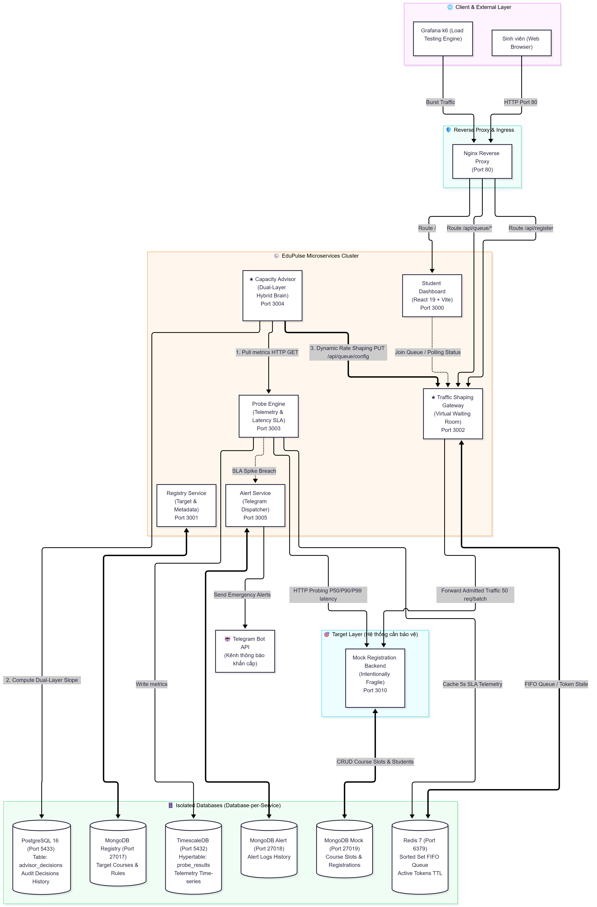
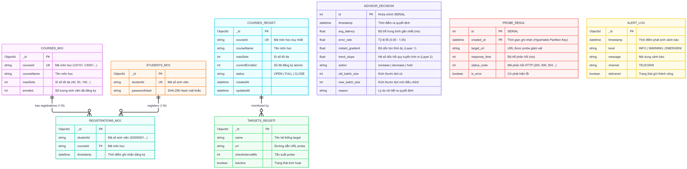
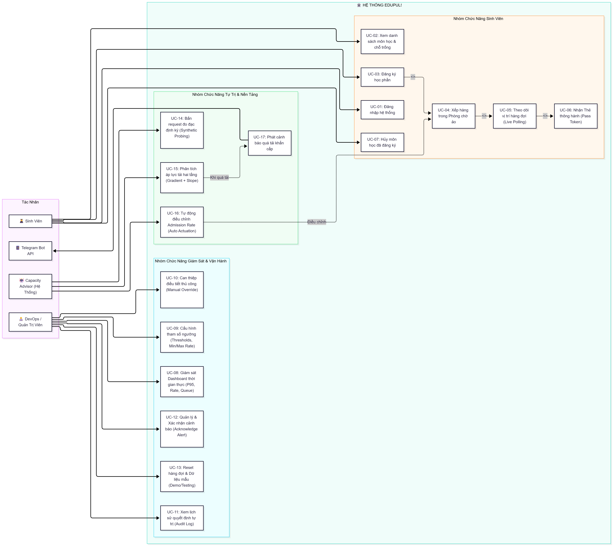
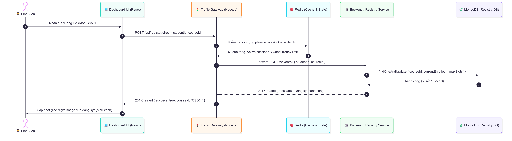
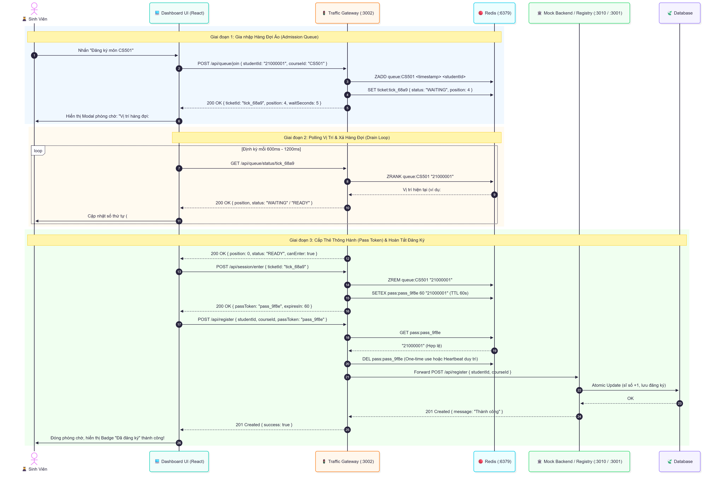
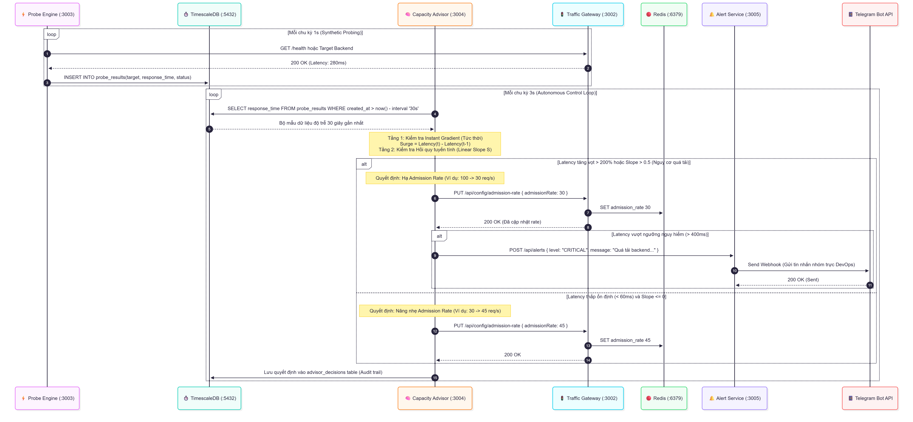
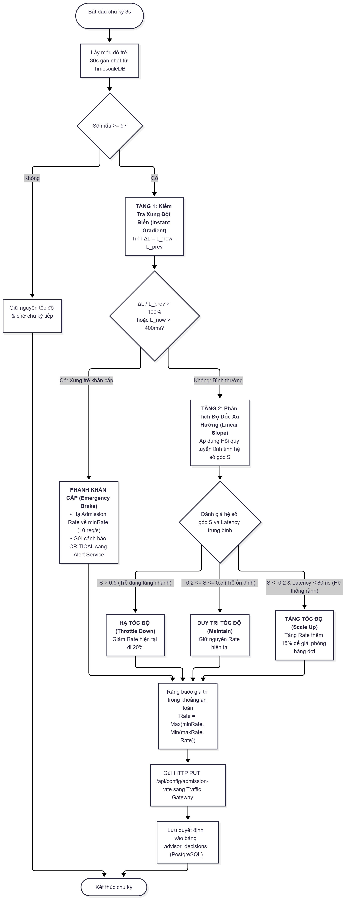

# 📚 EduPulse — Tài Liệu Kiến Trúc & Sơ Đồ Hệ Thống (System Architecture & Diagrams)

> **Đề tài NCKH:** Nền tảng điều tiết lưu lượng và bảo vệ hệ thống đăng ký tín chỉ tự trị dựa trên kiểm soát đón nhận thích ứng (EduPulse)  
> **Nhóm tác giả:**  
> - **Trương Minh Thành** — Trưởng nhóm, DevOps & Kiến trúc hệ thống (Lead Architect)  
> - **Lâm Tấn Đạt** — Backend & Động cơ phân tích dữ liệu (Data Engine)  
> - **Lâm Vĩ Hoằng** — Frontend & Tích hợp trải nghiệm người dùng (Integration)  
> **Phiên bản:** Phase 1 Final  
> **Cập nhật:** Tháng 11/2026

---

## 📑 MỤC LỤC TỔNG QUAN

1. [Tổng quan đề tài & Triết lý thiết kế](#1-tổng-quan-đề-tài--triết-lý-thiết-kế)
2. [Sơ đồ Kiến trúc Microservices (Architecture Diagram - MAD)](#2-sơ-đồ-kiến-trúc-microservices-architecture-diagram---mad)
3. [Sơ đồ Thực thể Quan hệ (Entity Relationship Diagram - ERD)](#3-sơ-đồ-thực-thể-quan-hệ-entity-relationship-diagram---erd)
4. [Biểu đồ Ca sử dụng (Use Case Diagram)](#4-biểu-đồ-ca-sử-dụng-use-case-diagram)
5. [Biểu đồ Trình tự (Sequence Diagrams)](#5-biểu-đồ-trình-tự-sequence-diagrams)
   - 5.1 [Đăng ký trực tiếp (Fast Path)](#51-đăng-ký-trực-tiếp-fast-path---sed_direct)
   - 5.2 [Phòng chờ ảo & Chu trình Vé (Queue & Pass Token Flow)](#52-phòng-chờ-ảo--chu-trình-vé-queue--pass-token-flow---sed_queuetoken)
   - 5.3 [Vòng lặp điều khiển tự trị (Autonomous Control Loop)](#53-vòng-lặp-điều-khiển-tự-trị-autonomous-control-loop---sed_controlloop)
6. [Biểu đồ Hoạt động (Activity Diagrams)](#6-biểu-đồ-hoạt-động-activity-diagrams)
   - 6.1 [Thuật toán điều tiết 2 tầng (Dual-Layer Capacity Control Flow)](#61-thuật-toán-điều-tiết-2-tầng-dual-layer-capacity-control-flow)
   - 6.2 [Tiếp nhận lưu lượng & Xếp hàng ảo tại Gateway (Traffic Ingestion & Waiting Room)](#62-tiếp-nhận-lưu-lượng--xếp-hàng-ảo-tại-gateway-traffic-ingestion--waiting-room)
7. [Đặc tả API Endpoints & Hồ sơ đính kèm](#7-đặc-tả-api-endpoints--hồ-sơ-đính-kèm)
8. [Hướng dẫn Khởi chạy Hệ thống (Quick Start)](#8-hướng-dẫn-khởi-chạy-hệ-thống-quick-start)

---

## 1. Tổng quan đề tài & Triết lý thiết kế

EduPulse giải quyết triệt để bài toán **nghẽn mạng giờ vàng khi sinh viên đăng ký học phần** thông qua kiến trúc **Sidecar / Reverse Proxy thông minh**:
- **Zero-Code Intrusion (Không can thiệp mã nguồn trường):** Nhà trường chỉ cần đổi bản ghi DNS hoặc cấu hình Reverse Proxy trỏ lưu lượng qua EduPulse Gateway mà không cần sửa đổi dù chỉ 1 dòng code backend đào tạo hiện hữu.
- **Closed-Loop Adaptive Feedback (Vòng phản hồi tự trị thích ứng):** Liên tục đo đạc độ trễ phản hồi thực tế của backend theo chu kỳ ngắn và tự động điều tiết tốc độ tháo van (Admission Rate) để giữ backend luôn trong vùng an toàn ($Latency < 200\text{ ms}$).
- **Virtual Waiting Room on RAM (Phòng chờ ảo hiệu năng cao):** Toàn bộ hàng đợi sinh viên được lưu giữ trên RAM Redis với độ trễ xử lý $\sim 1\text{ ms}$, loại trừ hoàn toàn rủi ro sập Database do bão tuyết request (Retry Storm).

---

## 2. Sơ đồ Kiến trúc Microservices (Architecture Diagram - MAD)



### 💡 Giải thích kiến trúc:
1. **Lớp Ingress (Nginx Reverse Proxy - Port 80):** Tiếp nhận lưu lượng từ trình duyệt sinh viên và Grafana k6 (Load Testing). Phân luồng `/` về Dashboard UI và `/api` về Traffic Gateway.
2. **Traffic Shaping Gateway (Port 3002):** Chốt chặn trung tâm, quản lý hàng đợi ảo (Virtual Waiting Room) bằng Redis, cấp vé xếp hàng (`ticketId`) và thẻ thông hành (`passToken`).
3. **Probe Engine (Port 3003):** Đo đạc chủ động (Synthetic Probing) mỗi 1 giây vào backend, ghi nhận Response Time theo chuỗi thời gian vào TimescaleDB và truyền luồng SSE (Server-Sent Events) lên Dashboard.
4. **Capacity Advisor (Port 3004):** "Bộ não" điều khiển tự trị, chạy chu kỳ mỗi 3 giây, áp dụng thuật toán 2 tầng (Instant Gradient + Linear Regression Slope) để tính toán và tự động cập nhật tốc độ đón nhận (`admissionRate`) sang Gateway.
5. **Alert Service (Port 3005):** Tiếp nhận sự cố quá tải nghiêm trọng từ Advisor và phát cảnh báo tức thì vào nhóm Telegram của đội ngũ DevOps.
6. **Backend Đào tạo (Port 3010 / 3001):** Hệ thống đào tạo của trường học (hoặc Mock Legacy Backend cố tình tạo độ trễ) nhận các request đăng ký đã được kiểm soát tốc độ an toàn.

---

## 3. Sơ đồ Thực thể Quan hệ (Entity Relationship Diagram - ERD)



### 💡 Giải thích mô hình dữ liệu (Database-per-Service / Polyglot Persistence):
- **Redis (`redis-gateway:6379`):**
  - `queue:{courseId}`: Cấu trúc **Sorted Set** với `score` là timestamp (ms) gia nhập, đảm bảo tính công bằng tuyệt đối vào trước ra trước (FIFO).
  - `ticket:{ticketId}`: Khóa lưu trạng thái vé của sinh viên (TTL: 300 giây).
  - `pass:{passToken}`: Khóa lưu thẻ thông hành tạm thời sau khi đến lượt (TTL: 60 giây).
  - `admission_rate`: Lưu trữ tốc độ xả van hiện hành (req/s).
- **TimescaleDB (`timescaledb:5432`):**
  - Hypertable `probe_results`: Phân vùng theo thời gian tự động, lưu trữ hàng triệu mẫu đo đạc độ trễ (`response_time`, `status_code`, `target_url`, `created_at`).
- **PostgreSQL (`postgres-advisor:5433`):**
  - Bảng `advisor_decisions`: Lưu vết kiểm toán (Audit Trail) của toàn bộ quyết định tự trị (`current_rate`, `recommended_rate`, `latency_slope`, `action`, `reason`).
- **MongoDB (`mongo-registry:27017` & `mongo-mock:27019`):**
  - Collection `courses`: Quản lý thông tin môn học, mã môn (`courseId`), tên môn, sĩ số tối đa (`maxSlots`) và số đã đăng ký (`currentEnrolled`).
  - Collection `registrations`: Lưu thông tin đăng ký kèm chỉ mục duy nhất `{ studentId: 1, courseId: 1 }` để chống đăng ký trùng lặp.
- **MongoDB Alert (`mongo-alert:27018`):**
  - Collection `alerts`: Quản lý cấp độ cảnh báo (`CRITICAL`, `WARNING`), thông điệp và trạng thái xử lý (`acknowledged`).

---

## 4. Biểu đồ Ca sử dụng (Use Case Diagram)



### 💡 Giải thích các tác nhân & ca sử dụng:
1. **Sinh viên (Student - Primary Actor):**
   - Đăng nhập hệ thống (`UC-01`).
   - Xem danh sách môn học và trạng thái chỗ trống (`UC-02`).
   - Đăng ký môn học (`UC-03`) — tự động bao gồm việc vào phòng chờ ảo (`UC-04`), polling vị trí hàng đợi (`UC-05`), và nhận thẻ thông hành `passToken` khi đến lượt (`UC-06`).
   - Hủy đăng ký môn học (`UC-07`).
2. **Kỹ sư DevOps / Quản trị viên (DevOps - Primary Actor):**
   - Giám sát Dashboard thời gian thực với biểu đồ P95, Admission Rate và Hàng đợi (`UC-08`).
   - Cấu hình ngưỡng bảo vệ hệ thống (`UC-09`).
   - Điều tiết thủ công tốc độ đón nhận (Manual Override) khi cần (`UC-10`).
   - Tra cứu nhật ký quyết định tự trị (`UC-11`) và xác nhận cảnh báo (`UC-12`).
   - Reset hàng đợi và dữ liệu thử nghiệm (`UC-13`).
3. **Capacity Advisor (Autonomous Agent - Secondary Actor):**
   - Định kỳ phân tích xu hướng tải hai tầng (`UC-15`).
   - Tự động kích hoạt điều chỉnh tốc độ Admission Rate (`UC-16`).
   - Kích hoạt cảnh báo khẩn cấp (`UC-17`) đẩy qua Telegram Bot Service khi độ trễ tăng vọt.

---

## 5. Biểu đồ Trình tự (Sequence Diagrams)

### 5.1 Đăng ký trực tiếp (Fast Path — SED_Direct)


- **Ngữ cảnh:** Hệ thống đang ở trạng thái rảnh hoặc tải thấp ($Latency < 100\text{ ms}$, không có hàng đợi).
- **Luồng xử lý:** Sinh viên gửi yêu cầu đăng ký $\to$ Gateway kiểm tra không có hàng đợi và tải an toàn $\to$ Chuyển tiếp thẳng (Direct Admission) đến Backend $\to$ Cập nhật sĩ số trong Database $\to$ Trả về kết quả thành công và giao diện chuyển ngay sang trạng thái "Đã đăng ký".

---

### 5.2 Phòng chờ ảo & Chu trình Vé (Queue & Pass Token Flow — SED_Queue&Token)


- **Ngữ cảnh:** Đợt mở cổng cao điểm khi hàng ngàn sinh viên đồng thời truy cập.
- **Luồng xử lý:**
  1. **Gia nhập hàng đợi:** Sinh viên nhấn "Đăng ký" $\to$ Gateway đưa vào Redis Sorted Set và cấp mã vé `ticketId` cùng vị trí ban đầu (ví dụ `#4`).
  2. **Polling vị trí:** Frontend gửi request định kỳ (600ms - 1.2s) để nhận vị trí cập nhật giảm dần (#4 $\to$ #3 $\to$ #2 $\to$ #1 $\to$ #0).
  3. **Đổi thẻ thông hành:** Khi vị trí đạt `#0` (READY), client gọi `POST /api/session/enter` để đổi vé lấy `passToken` (có hiệu lực 60s trên Redis).
  4. **Hoàn tất đăng ký:** Client gửi lệnh đăng ký kèm `passToken` $\to$ Gateway xác thực token hợp lệ $\to$ Cho phép chuyển tiếp vào Backend ghi nhận thành công.

---

### 5.3 Vòng lặp điều khiển tự trị (Autonomous Control Loop — SED_ControlLoop)


- **Ngữ cảnh:** Hoạt động nền liên tục 24/7 để tự động cân bằng tải.
- **Luồng xử lý:**
  1. `probe-engine` thăm dò backend mỗi 1 giây và ghi độ trễ vào TimescaleDB.
  2. `capacity-advisor` mỗi 3 giây đọc dữ liệu 30 giây gần nhất, đánh giá 2 tầng:
     - Nếu phát hiện xung trễ tức thì hoặc độ dốc $S > 0.5 \to$ Tự động hạ Admission Rate (ví dụ từ 100 xuống 30 req/s) và cập nhật sang Redis Gateway.
     - Nếu độ trễ vượt ngưỡng nghiêm trọng ($> 400\text{ ms}$) $\to$ Bắn webhook cảnh báo qua Alert Service tới Telegram của DevOps.
     - Nếu hệ thống ổn định và tải thấp $\to$ Tự động tăng nhẹ Admission Rate để giải phóng hàng đợi nhanh hơn.
  3. Mọi hành động đều được lưu vết kiểm toán vào PostgreSQL.

---

## 6. Biểu đồ Hoạt động (Activity Diagrams)

### 6.1 Thuật toán điều tiết 2 tầng (Dual-Layer Capacity Control Flow)


- **Tầng 1 — Kiểm tra Xung Đột Biến (Instant Gradient Check):**  
  So sánh chênh lệch trễ $\Delta L = L_{t} - L_{t-1}$. Nếu $\frac{\Delta L}{L_{t-1}} > 100\%$ hoặc $L_{now} > 400\text{ ms} \to$ Kích hoạt ngay **Phanh Khẩn Cấp (Emergency Brake)**, hạ tốc độ về mức sàn an toàn (`minRate = 10 req/s`) và phát cảnh báo `CRITICAL`.
- **Tầng 2 — Phân Tích Độ Dốc Xu Hướng (Linear Slope Analysis):**  
  Áp dụng công thức hồi quy tuyến tính tính hệ số góc $S$:
  - $S > 0.5$ (Trễ đang tăng nhanh): Giảm tốc độ hiện tại đi 20%.
  - $-0.2 \le S \le 0.5$ (Trễ ổn định): Duy trì nguyên tốc độ.
  - $S < -0.2$ và Latency thấp: Mở van tăng thêm 15% để giải tỏa hàng đợi.

---

### 6.2 Tiếp nhận lưu lượng & Xếp hàng ảo tại Gateway (Traffic Ingestion & Waiting Room)


- **Bước 1 (Xác thực Thẻ):** Kiểm tra request có mang `passToken` hợp lệ không. Nếu có và hợp lệ $\to$ Forward vào Backend và hoàn tất đăng ký.
- **Bước 2 (Kiểm tra Hàng đợi):** Nếu chưa có thẻ, kiểm tra hàng đợi hiện tại. Nếu rỗng và tải thấp $\to$ Cho phép đi đường tắt (Fast Path).
- **Bước 3 (Xếp hàng & Polling):** Nếu đang có hàng đợi $\to$ Cấp vé `ticketId` trong Redis $\to$ Client polling vị trí $\to$ Khi đến lượt đổi lấy `passToken` và gửi lại yêu cầu đăng ký an toàn.

---

## 7. Đặc tả API Endpoints & Hồ sơ đính kèm

- **Bảng tính Excel đặc tả toàn bộ Endpoints:**  
  👉 Chi tiết toàn bộ các route, method, request payload, response schema và HTTP status code của 6 microservices được tổng hợp trong file:  
  📁 [`docs/Endpoints/EduPulse_API_Endpoints.xlsx`](./Endpoints/EduPulse_API_Endpoints.xlsx)
- **Tài liệu Thiết kế Kiến trúc Hệ thống chi tiết (System Design Document):**  
  👉 Báo cáo thiết kế giải pháp tổng thể, cơ chế chịu lỗi (Fault-Tolerance), suy thoái mềm (Graceful Degradation) và bảo mật chống gian lận:  
  📁 [`docs/system_design.md`](./system_design.md)
- **Báo cáo Tiến độ Đề tài (PowerPoint Presentation):**  
  📁 [`docs/Báo_cáo_tiến_độ_đề_tài.pptx`](./Báo_cáo_tiến_độ_đề_tài.pptx)

---

## 8. Hướng dẫn Khởi chạy Hệ thống (Quick Start)

Hệ thống EduPulse đã được container hóa hoàn chỉnh bằng Docker Compose:

```bash
# 1. Khởi động toàn bộ 14 containers (Microservices + Databases)
docker compose up -d

# 2. Kiểm tra trạng thái các dịch vụ đang chạy
docker compose ps

# 3. Truy cập các cổng giao tiếp chính:
# - Cổng Web Dashboard & Đăng ký: http://localhost:3000
# - Cổng Reverse Proxy chung:      http://localhost:80
# - Cổng Traffic Gateway:           http://localhost:3002
# - Cổng Probe Engine:              http://localhost:3003
# - Cổng Capacity Advisor:          http://localhost:3004
# - Cổng Alert Service:             http://localhost:3005
```
